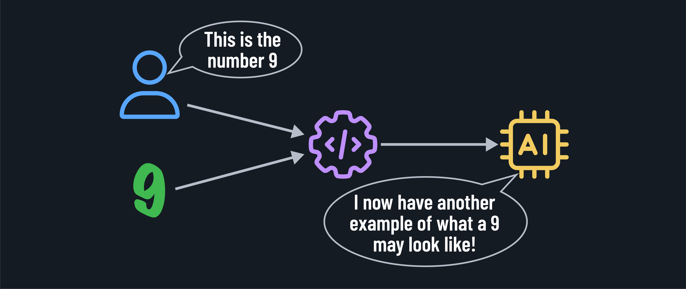
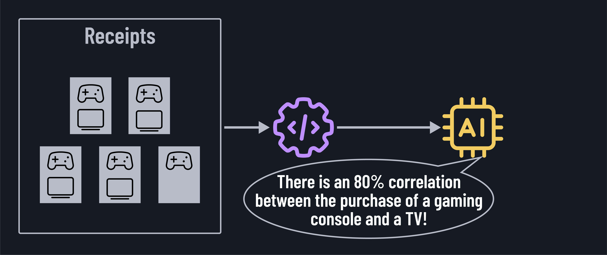

<h1>
  AI and ML Fundamentals for IT
  Diving Into Machine Learning
</h1>

**Learning objective:** By the end of this lesson, students will be able to discuss the key components of machine learning (ML), including training data, features, and algorithms, and explore popular ML techniques used in real-world applications.

## What is machine learning (ML)?

Machine learning is a subset of AI. However, it has become the dominant approach to building AI systems because most cutting-edge technologies (like voice assistants, translators, self-driving car vision, and more) are built using ML techniques. ML is the engine driving modern AI advances by enabling systems to improve themselves as they gain more data.

This is because ML allows computers to learn from data and improve over time without being explicitly programmed, similar to how humans learn from experience. In other words, ML is how we've been able to create narrow AI systems.

ML enables computers to analyze large amounts of data like images or text, identify patterns, and make predictions or decisions based on that data. It's like teaching a computer to learn by itself!

### Key concepts of machine learning

- **Training data**: ML models learn from vast amounts of data. The more diverse and representative the data, the better the model can learn and generalize. For example, to train a model to predict housing prices, you would need a dataset containing information about houses (size, location, features) and their corresponding prices.

- **Features**: Features are the input variables used to train the model. They're like the characteristics or attributes of the data. In the housing price prediction model above, features could include the size of the house, number of bedrooms, location, and proximity to amenities.

- **Algorithms**: ML algorithms are the brains behind the learning process. They determine how the model learns from the data and makes predictions. For example, linear regression is an algorithm that learns to predict a continuous value (like price) based on input features by finding the best-fitting line through the data points.

## Training a model

Many different methods can be used to train a model, the most popular being supervised, unsupervised, and reinforcement learning. These methods and others can be used in isolation or combination to train a model.

### Supervised learning

The AI system learns from labeled data, where the desired output is known. It's like having a teacher guide the learning process.

An example of supervised learning is training an AI to recognize handwritten digits by providing it with labeled images of digits and their corresponding numbers, as shown above. With thousands more examples of the number nine and other letters and numbers, the AI system can learn to identify letters and numbers in new images it has never seen.

### Unsupervised learning

When unsupervised learning is used, the AI system learns from unlabeled data, discovering hidden patterns and structures on its own. It's like exploring uncharted territory!

In the example of unsupervised learning above, the system has identified a purchasing pattern. This pattern can be used to suggest items to users while they shop.

### Reinforcement learning

The AI system learns through rewards and punishments, similar to how we train pets. It's all about learning from feedback! Teaching an AI to play a game by rewarding it for winning moves and penalizing it for losing ones is an example of reinforcement learning.

## Machine learning in action

Machine Learning is transforming various domains. Here are a few exciting examples:

### Image recognition

ML-powered AI can identify objects, faces, and even complex ideas, such as emotions, in images and videos. A common example is the photo tagging feature on social media, where the app suggests who is in a photo by recognizing faces – that's an ML vision model at work.

### Natural language processing (NLP)

ML systems that understand written language and respond to requests. They interpret the meaning of your words and formulate a helpful answer or action. NLP is the magic behind chatbots and language translation! These systems can perform actions like sentiment analysis of customer reviews to gauge product satisfaction.

### Recommendation engines

Platforms can use ML algorithms to learn from your past behavior along with the past behavior of millions of other users and predict what you'll enjoy. These recommendation systems are a big part of e-commerce and entertainment platforms, using AI to personalize your experience.

  <h2 class="title">Identify real-world use of AI</h2>
  5 min

From virtual assistants like Siri and Alexa to recommendation systems on Netflix and Amazon, AI and ML are everywhere! It's also revolutionizing industries like healthcare, finance, and transportation. Let's take a few minutes to discuss where you see AI in your daily life.

- Can you think of other examples of AI systems you interact with in your daily life?
- How do you imagine AI will shape the future of various industries?
